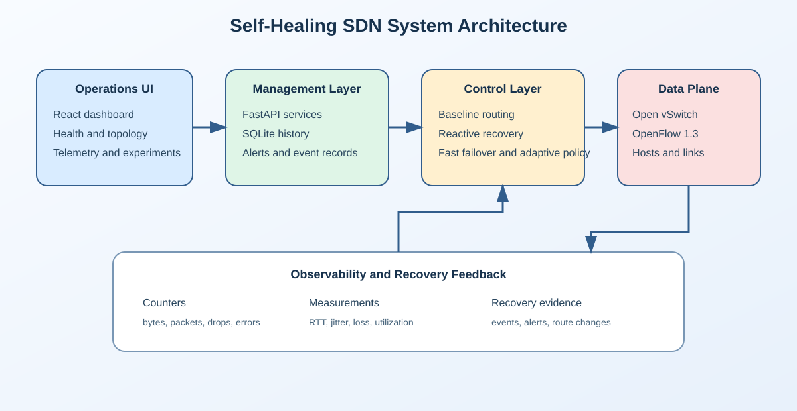
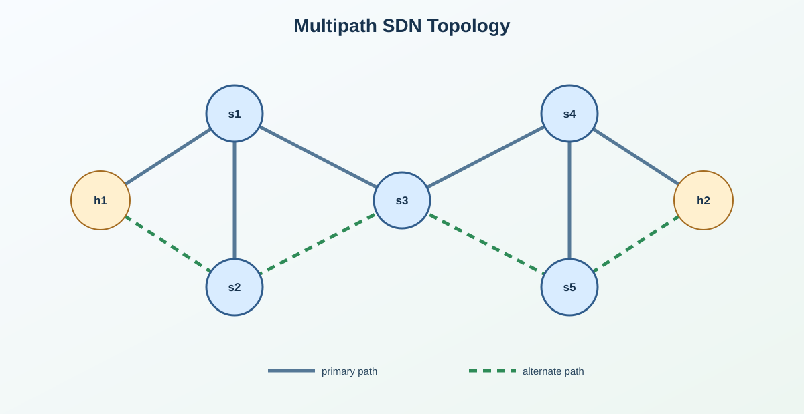
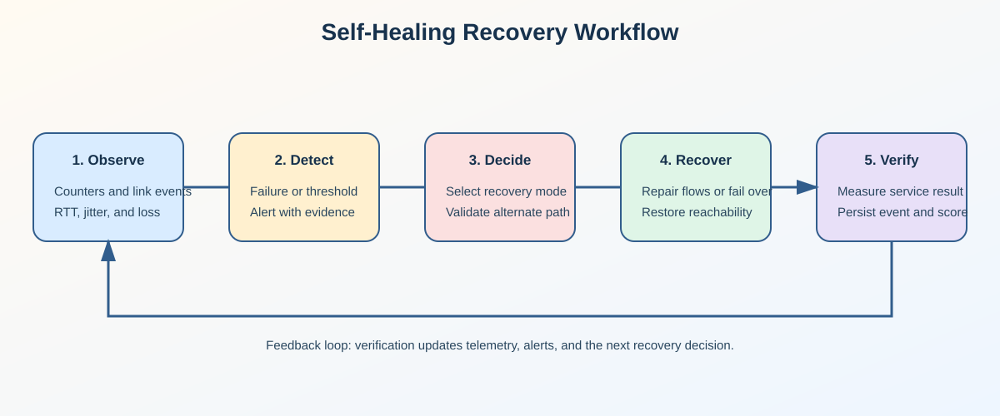

# IEEE Paper Package

This folder contains the IEEE conference paper source:

- `main.tex` — complete 914-line manuscript.
- `references.bib` — IEEE bibliography entries.
- `paper-preview.html` — standalone browser preview with a print button.
- `figures/` — topology, healing, fast-failover, and labelled-results figures.

The manuscript covers the system architecture, problem scenario, research
questions, mathematical model, recovery algorithms, controller baselines,
experimental setup, telemetry and alert methodology, measured scenario results,
graphs, performance analysis, discussion, deployment considerations,
implementation traceability, API contracts, reproducibility protocol, data
dictionary, extended results interpretation, project deliverables, conclusion,
and IEEE references.

Open `paper-preview.html` in a browser to inspect the paper layout. Use the
**Print paper** button or the browser print command to print/save the preview as
PDF. The HTML preview approximates the IEEE two-column layout; the Overleaf
LaTeX source remains the authoritative submission version.

Replace the student author block in `main.tex` with the course-project authors
and institution details before submission.

## SDN diagrams

The following diagrams are included for documentation and
presentation use. They are standalone SVG files and can be opened directly in
a browser or inserted into a Markdown report:

### System architecture

### Multipath topology

### Recovery workflow

